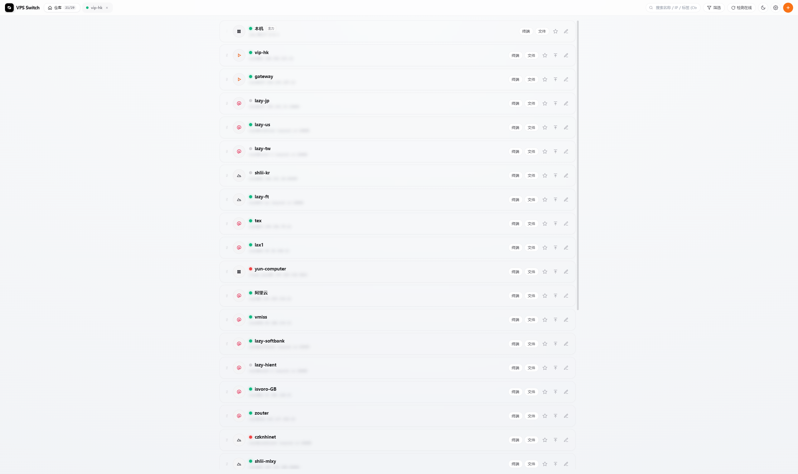
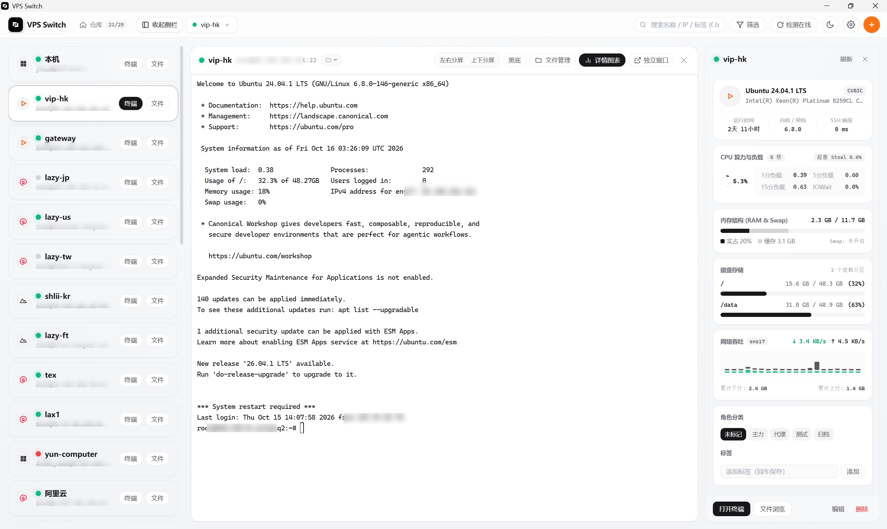
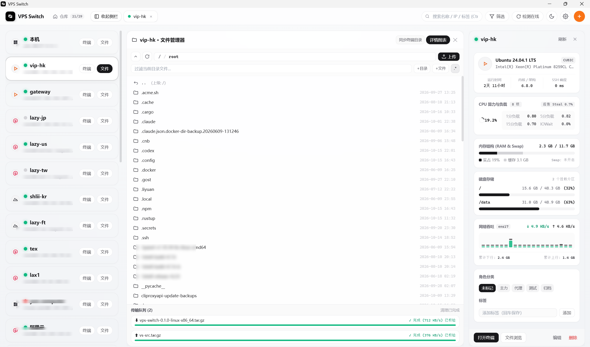
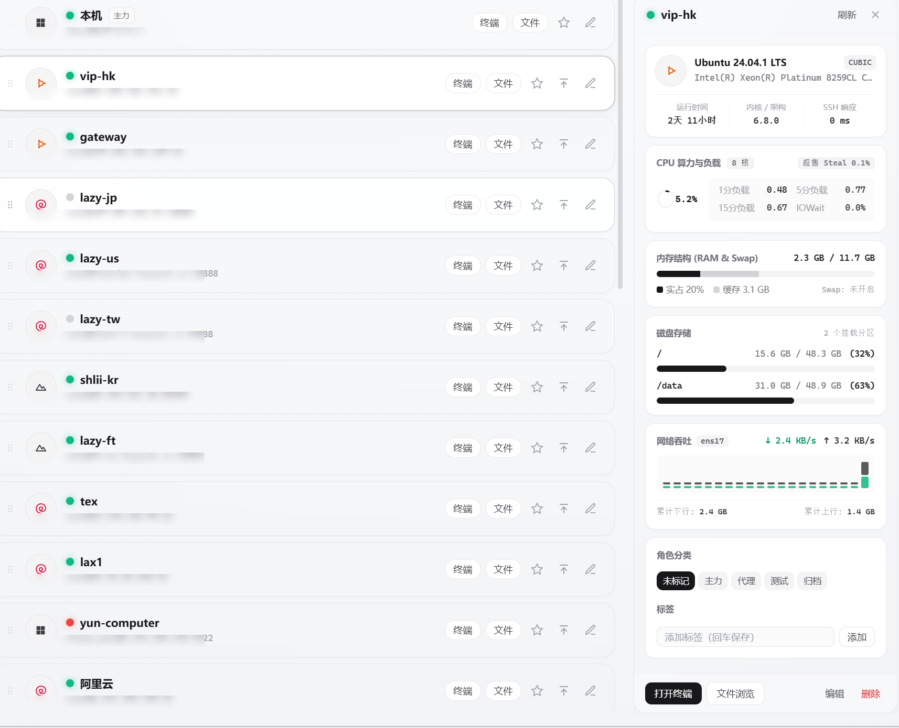
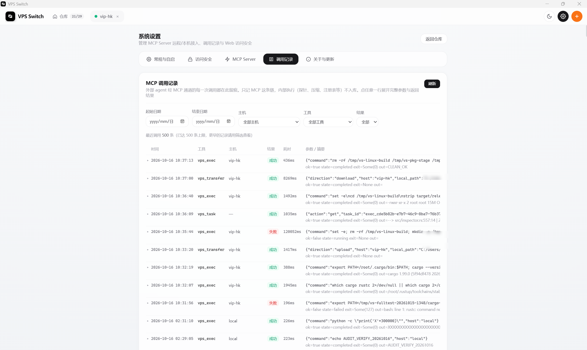

# VPS Switch

轻量级 VPS 管理器与面向 AI Agent 远程操控 VPS 的 MCP Server。

VPS Switch 是一个本地优先的主机管理工具。它集成了终端、文件管理与系统探针等基础功能，并通过标准 MCP 协议为 AI Agent（Claude Code、Codex 等）提供多主机协同调度的远程执行底座。

一份纯 Rust 后端，桌面 UI 与 MCP 接口共用同一套高并发连接池与状态机。

---

## 多系统与异构环境适配

无论是桌面端的人工操作，还是外部 Agent 经由 MCP 下达调度指令，底层均提供透明的系统环境适配：

- **主流 Linux 发行版**：全面支持 Debian、Ubuntu、CentOS 等常见系统，并特别适配了 Alpine 等基于 musl libc / busybox (ash) 的超轻量精简环境；
- **Windows 远端主机**：针对 Windows OpenSSH 做了深度优化。底层自动转译为 PowerShell Base64 UTF-16LE 载荷并强制注入 UTF-8 输出，自动拦截清洗 PowerShell 5.1 CLIXML 管道噪音，彻底根除 cmd 转义卡死与中文乱码；
- **POSIX / BSD 体系**：基于标准 OpenSSH 协议栈构建，理论上兼容 macOS 等 BSD 兼容环境。

---

## 界面展示

### 1. 主机仓库与连接底座
单栏横条卡片列表，直观展示多台 VPS 在线状态（SSH 握手即亮，无需等待探针）；支持标签过滤与快速搜索。连接建立时轻量探测远端真实的 Linux 发行版、内核架构与硬件信息。



### 2. 三栏联动工作台与终端
左侧迷你仓库、中间终端、右侧系统详情三栏联动作业。Rust 后端常驻持有终端网格状态（`alacritty_terminal`），切页与断线重连瞬间恢复现场；随包携带最新版 Windows ConPTY，支持 OSC 133 命令边界与退出码截获；支持一键将当前终端抽离为独立桌面窗口。



### 3. 文件管理与流式传输
支持高并发 SFTP 目录树浏览，内嵌 CodeMirror 在线文本编辑器。文件传输走独立的流式传输引擎，支持断点续传残片对账与落地 SHA-256 闭环校验。



### 4. 轻量探针看板
直接读取 Linux `/proc` 与 Windows 性能计数器差分计算，智能锁定主物理网卡，杜绝虚拟网卡叠加造成的网速虚高。按需刷新，打开看板时实时更新，平时后台静默不产生多余轮询。



### 5. MCP 调用留痕与审计
外部 Agent 的每一次工具调用均在独立面板中全程留痕。支持按时间范围、目标主机、调用工具与成败状态多维筛选，可展开查看完整输入参数与执行结果。内置命令不可逆黑名单护栏（如 `rm -rf /` 等危险操作执行前直接拦截防手滑）。



---

## 下载与安装

前往 [**GitHub Releases**](https://github.com/weidu12123/vps-switch/releases/latest) 获取最新版本：

### Windows
- **`vps-switch-0.1.0-windows-x64-setup.exe`（推荐）**：标准向导安装程序，内置 GPUI 原生桌面客户端（`vps-switch-gpui.exe`）、后端守护进程（`vps-switch.exe`）与随包 Windows ConPTY，自动配置开始菜单与桌面快捷方式。
- **`vps-switch-0.1.0-windows-x64-portable.zip`**：免安装绿色便携版，解压后双击 `vps-switch-gpui.exe`（或 `vps-switch.exe`）即可启动 GPUI 原生桌面客户端。
- **`vps-switch-0.1.0-x86_64.msi`**：Windows 原生 MSI 包，适合命令行自动化部署（会把安装目录加进系统 PATH）。

> *Windows 运行提示：*
> 1. *GPUI 原生客户端使用 DirectX 11 硬件加速渲染（虚拟机模拟显示适配器同样可用并自动降级动画）。*
> 2. *因未购买商业代码签名证书，首次运行若遇 Windows SmartScreen 提示“未知发布者”，点击「更多信息」→「仍要运行」即可。*

### Linux (x86_64)
适用于将 VPS Switch 作为无头服务直接部署在云服务器或中转机上，Web 前端已完整内嵌在单一二进制中：

```bash
# 解压
tar -xzf vps-switch-*-linux-x86_64.tar.gz
cd vps-switch-*-linux-x86_64

# 快速运行（默认监听 18800 端口，浏览器访问 http://<你的IP>:18800）
./vps-switch

# 或使用附带的 systemd 脚本配置开机自启
sudo mkdir -p /opt/vps-switch
sudo cp vps-switch /opt/vps-switch/
sudo cp vps-switch.service /etc/systemd/system/
sudo systemctl daemon-reload
sudo systemctl enable --now vps-switch
```

*Linux 首启默认开启 Web 登录密码，默认初始凭据为：`admin` / `vps-switch`（登录后可在设置面板修改）。*

---

## 接入 Claude Code / Agent

在设置页中开启 MCP Server 服务（本机 127.0.0.1 访问默认免 API Key 鉴权）。

### 一键接入 Claude Code
在终端中直接运行：

```bash
# 本机模式
claude mcp add --transport http --scope user vps-switch http://127.0.0.1:18800/mcp

# 远端模式（附带 API Key，走 Authorization: Bearer）
claude mcp add --transport http --scope user vps-switch http://<服务器IP>:18800/mcp \
  -H "Authorization: Bearer YOUR_API_KEY"
```

> `--transport http` 不能省：不写时 `claude mcp add` 按 stdio 处理，会把 URL 当成命令。
> 远端鉴权只认 `Authorization: Bearer <KEY>` 与 `X-API-Key: <KEY>` 两种头，可在设置页复制现成的配置 JSON。

### Agent 可调用的核心工具

| 工具名称 | 作用说明 |
|---|---|
| `vps_list` | 查询已配置的主机列表与元数据，支持关键字搜索与状态过滤 |
| `vps_inspect` | 获取一台或多台主机的实时硬件指标（CPU、内存、磁盘、网速、负载） |
| `vps_exec` | 在一台或多台主机上并发执行命令，支持主机名寻址；自动路由适配 Linux（Shell）与 Windows（PowerShell 编码转译），Agent 无需关心系统差异；短任务同步返回，长任务支持阻塞等待 |
| `vps_task` | 查询或取消后台运行中的长时间任务，支持 `wait_seconds` 阻塞等待完成 |
| `vps_fs` | 远程文件系统操作（列目录、读写改删、压缩解压），带单文件读写大小保护 |
| `vps_transfer` | 高速文件流式传输（上传/下载），支持断点续传残片对账与落地 SHA-256 校验 |
| `vps_terminal` | 打开、读取或向交互式终端发送输入，遇到交互确认支持唤醒桌面 UI 人工介入 |

---

## 技术架构

- **桌面客户端（GPUI 原生）**：`gpui-kit 0.7.3`（`gpui-pre 0.3.9`）+ `alacritty_terminal 0.26` 自绘终端网格 + Tree-Sitter 在线代码编辑器 + 原生系统托盘（零 WebView2 / Chromium 依赖）
- **后端守护进程**：Rust + Tokio + Axum（单一常驻进程，提供 HTTP REST、二进制终端 WebSocket、SSE 事件流与 MCP Server）
- **SSH 底座**：纯异步 `russh` 0.63 + `russh-sftp`（单主机多 channel 复用、跳板机穿透与 SFTP 会话自愈）
- **终端引擎**：`alacritty_terminal` 权威网格 + 2 MiB 历史字节环 + 随包 Windows ConPTY + OSC 133/7 命令边界与工作目录追踪
- **Web 控制台（Linux 无头内嵌）**：Vue 3 + TypeScript + Tailwind CSS + xterm.js + CodeMirror 6
- **本地存储**：单文件 SQLite（`rusqlite` bundled）+ 关键凭据 AES-GCM 本地加密

### 内存占用

#### Linux 无头部署（实测，Ubuntu 24.04 / 8 核）

| 状态 | RSS |
|---|---|
| 空闲常驻 | **9.7 MB** |
| 一次本机探针之后 | 10.4 MB |
| 并发 8 条大输出命令之后 | 39.7 MB |
| 打开无头终端 pane 之后 | 41.2 MB |

空闲基线就是 10 MB 上下，这也是把 VPS Switch 当常驻服务跑在 128 MB 小机器上仍然宽裕的原因。

第三行的涨幅来自命令输出缓冲：每条任务 stdout/stderr 各留最多 1 MiB，且**结果会刻意留在任务表里**
（agent 之后要能取回），所以并发大输出之后不会立刻回落——这是取舍，不是泄漏。

> 顺带一提：`top` 的 VIRT 列会显示几百 MB 到 1 GB，那是地址空间不是内存占用（线程栈与
> 预留缓冲），看 RSS 即可。

#### Windows GPUI 原生桌面版（实测，Windows 11 / 29 台 VPS 机队）

| 进程 | 工作集 (Working Set) | 私有内存 (Private) | 说明 |
|---|---:|---:|---|
| `vps-switch.exe --headless` | **28.8 MB** | **7.0 MB** | 后端守护进程（连接池 + SQLite + MCP Server） |
| `vps-switch-gpui.exe` | **72.7 MB** | 116.4 MB | GPUI 原生客户端（DirectX 渲染 + 终端 + 编辑器 + 托盘） |
| **合计（客户端 + 守护进程）** | **101.5 MB (~0.1 GB)** | **123.4 MB** | **共 2 个进程，零 Chromium / WebView2 子进程** |

相比旧 WebView2 桌面壳（7 个进程、常驻工作集约 340 MB），GPUI 原生版常驻工作集直降约 **70%**（省下 ~240 MB）；且弹出多个独立终端窗口均在同一个客户端进程内共享渲染上下文，不再随窗口数量按百 MB 累加。

---

## 从源码构建

仓库里不含构建产物，直接 `cargo build` 会失败（`frontend/dist` 与随包的 ConPTY 二进制都不入库）。仓库根目录的 `rust-toolchain.toml` 已锁定 Rust `1.99.1`。

```bash
# 1. 前端：先产出 frontend/dist（RustEmbed 在编译期读取它，缺了会编译报错）
cd frontend
pnpm install
pnpm build
cd ..

# 2. 随包的 Windows ConPTY：从 Windows Terminal 发布包取这两个文件放到仓库根目录
#    （portable-pty 按 DLL 搜索顺序从 exe 同级目录加载 conpty.dll）
#    conpty.dll  OpenConsole.exe

# 3. 编译后端守护进程与 GPUI 原生桌面客户端
cargo build --release -p vps-switch -p vps-switch-gpui
# 产物：target/release/vps-switch-gpui.exe 与 target/release/vps-switch.exe
```

Linux 无头服务只需编译 `vps-switch` 包（`cargo build --release -p vps-switch`），Web 控制台已内嵌进单一二进制。
